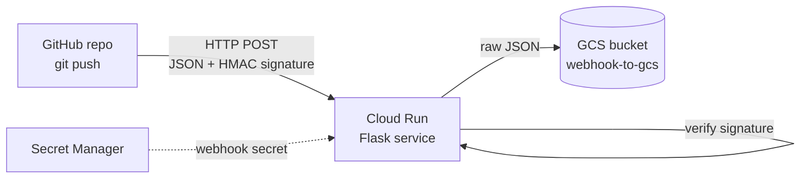

# github-webhook-to-gcs

A minimal, production-minded **GitHub webhook receiver** deployed on **Google Cloud Run** that lands every event, untouched, in **Google Cloud Storage**.

This is the first step of a data pipeline portfolio: the **ingestion / raw (bronze) layer**.



---

## Why serverless is a perfect fit for webhooks

A webhook is **event-driven by nature**: the sender (GitHub) decides *when* to call you, and you have no control over the timing or the volume. That makes it a 100% fit for a serverless platform like Cloud Run:

- **Idle most of the time**: events arrive only when something happens (a push, a ping). A 24/7 server would sit idle almost all day. Cloud Run **scales to zero** and you pay only while a request is being processed.
- **Bursty and unpredictable traffic**: if many events arrive at once, Cloud Run **scales out automatically**; when traffic stops, it scales back down.
- **Stateless, short-lived requests**: each event is independent, gets processed in milliseconds and doesn't need memory of previous events. That is exactly the execution model of serverless.
- **Push model**: the sender pushes the data to us, so there is no need for a long-running process that keeps a connection open or polls for new data (unlike a streaming consumer).
- **Zero infrastructure to manage**: no VMs, no patching, HTTPS endpoint out of the box.

---

## How it works

The whole service lives in `main.py` and is built from **three small functions** plus a route that orchestrates them.

### 1. `receive_event()`
Reads the incoming request from GitHub:
- the **raw body** (kept as bytes, exactly as sent, because the signature is computed over these bytes)
- `X-GitHub-Event`: the event type (`push`, `ping`, ...)
- `X-GitHub-Delivery`: a unique ID for each delivery

### 2. `verify_signature()`
Since the Cloud Run URL is public, anyone could call it. This function makes sure the request **really comes from GitHub**:
- GitHub signs every payload with `HMAC-SHA256(secret, body)` and sends it in the `X-Hub-Signature-256` header.
- The service recomputes the signature with the same shared secret and compares both values with `hmac.compare_digest` (constant-time comparison).
- If the secret is not configured, every request is rejected, so the endpoint can never be left open by mistake.

### 3. `upload_to_gcs()`
Stores the raw payload in the bucket, **without any transformation**, using a Hive-style partitioned path:

```
gs://webhook-to-gcs/raw/github/<event>/dt=YYYY-MM-DD/<delivery_id>.json
```

- **Partitioning by event type and date** (`dt=`) makes it easy to query by day later from BigQuery or Spark.
- **Using the delivery ID as the file name** means a redelivered event overwrites the same object instead of creating a duplicate.

### The route: `pipeline()`
`POST /` chains the three functions inside a `try/except`:

| Result | HTTP code |
|---|---|
| Valid signature, event stored | `200` |
| Missing or invalid signature | `401` |
| Any unexpected error | `500` (with the error reason) |

---

## Example of stored data

```
raw/github/
├── ping/dt=2026-11-17/<delivery_id>.json
└── push/dt=2026-11-17/<delivery_id>.json
```

A `push` event contains, among other fields: `ref` (branch), `before` / `after` (commit SHAs), `pusher`, and the list of `commits` with message, author, timestamp and `added` / `modified` / `removed` files.

> **Note:** the raw layer keeps the data exactly as GitHub sends it. For example, GitHub mixes timestamp formats inside the same object (`created_at` as epoch, `updated_at` as ISO string). Normalizing that is the job of the next layer (silver), not the ingestion layer.

---

## Tech stack

- **Python 3.10** + **Flask** + **Gunicorn**
- **Google Cloud Run**: serverless container runtime
- **Google Cloud Storage**: raw data lake
- **Secret Manager**: stores the webhook secret
- **Artifact Registry**: container images
- **Docker**

---

## Security and IAM

Two dedicated service accounts, following the principle of least privilege:

| Service account | Purpose | Permissions |
|---|---|---|
| `portfolio-runtime` | Identity the Cloud Run service runs as | `storage.objectCreator` on the bucket, `secretmanager.secretAccessor` on the secret |
| `portfolio-deployer` | Builds and deploys the service | Cloud Run deploy, `artifactregistry.writer` on the repository |

- The webhook secret is **never** in the code or the image: it is injected at runtime from Secret Manager as the `GITHUB_WEBHOOK_SECRET` environment variable.
- The service is publicly invokable (GitHub cannot authenticate against Google), so **the HMAC signature is the security layer**.

---

## Setup

### 1. Create the bucket and the secret

```bash
gcloud storage buckets create gs://webhook-to-gcs --location=us-central1

# Use tr -d '\n' so the secret is stored without a trailing newline
openssl rand -hex 32 | tr -d '\n' | gcloud secrets create github-webhook-secret --data-file=-
```

### 2. Deploy to Cloud Run

```bash
gcloud run deploy webhook-to-gcs \
  --image=us-central1-docker.pkg.dev/<PROJECT_ID>/webhook-to-gcs/webhook-to-gcs \
  --region=us-central1 \
  --service-account=portfolio-runtime@<PROJECT_ID>.iam.gserviceaccount.com \
  --set-secrets=GITHUB_WEBHOOK_SECRET=github-webhook-secret:latest

# Make the service publicly invokable (run once)
gcloud run services add-iam-policy-binding webhook-to-gcs \
  --region=us-central1 --member="allUsers" --role="roles/run.invoker"
```

### 3. Configure the webhook in GitHub

**Settings → Webhooks → Add webhook**

- **Payload URL:** your Cloud Run service URL
- **Content type:** `application/json`
- **Secret:** the value stored in Secret Manager
- **Events:** *Just the push event*

GitHub immediately sends a `ping` event, which should appear in the bucket under `raw/github/ping/`.

---

## Testing

- **From GitHub:** *Settings → Webhooks → Recent Deliveries* shows each request and the service response. Use **Redeliver** to resend any event.
- **With a real event:** `git commit --allow-empty -m "test" && git push`
- **Check the bucket:** `gcloud storage ls -r gs://webhook-to-gcs/raw/github/`
- **Logs:** `gcloud run services logs read webhook-to-gcs --region=us-central1`

---

## Next steps in the portfolio

This repo is the first piece of an end-to-end data pipeline:

1. **Webhook ingestion** (this repo): GitHub → Cloud Run → GCS
2. **Streaming ingestion**: Wikimedia EventStreams → Pub/Sub → GCS
3. **Transformation**: GCS → BigQuery (bronze → silver → gold) with dbt
4. **Orchestration and monitoring**
